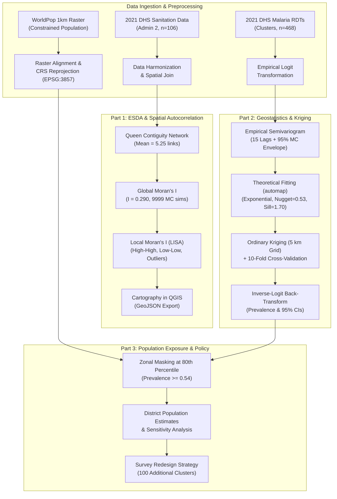
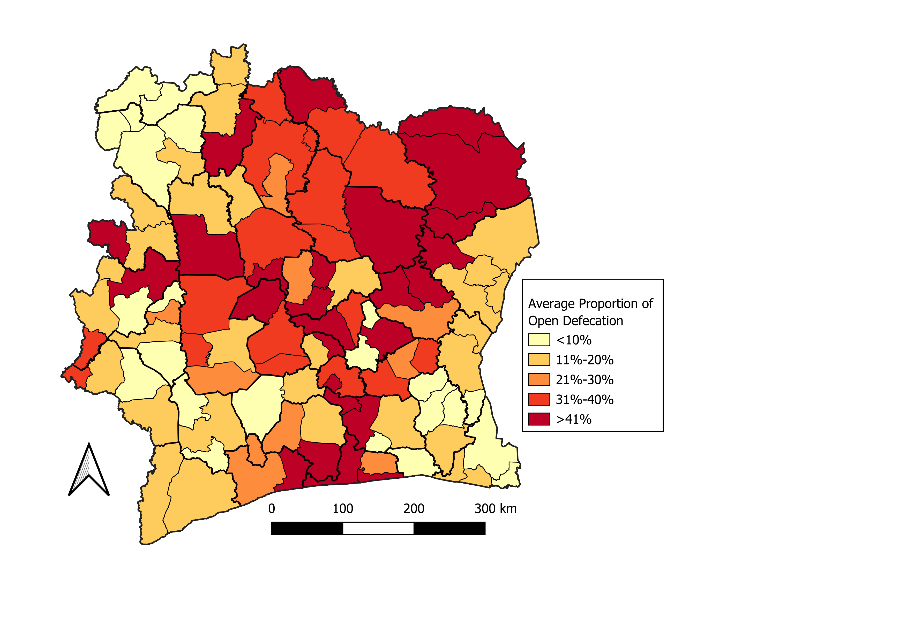
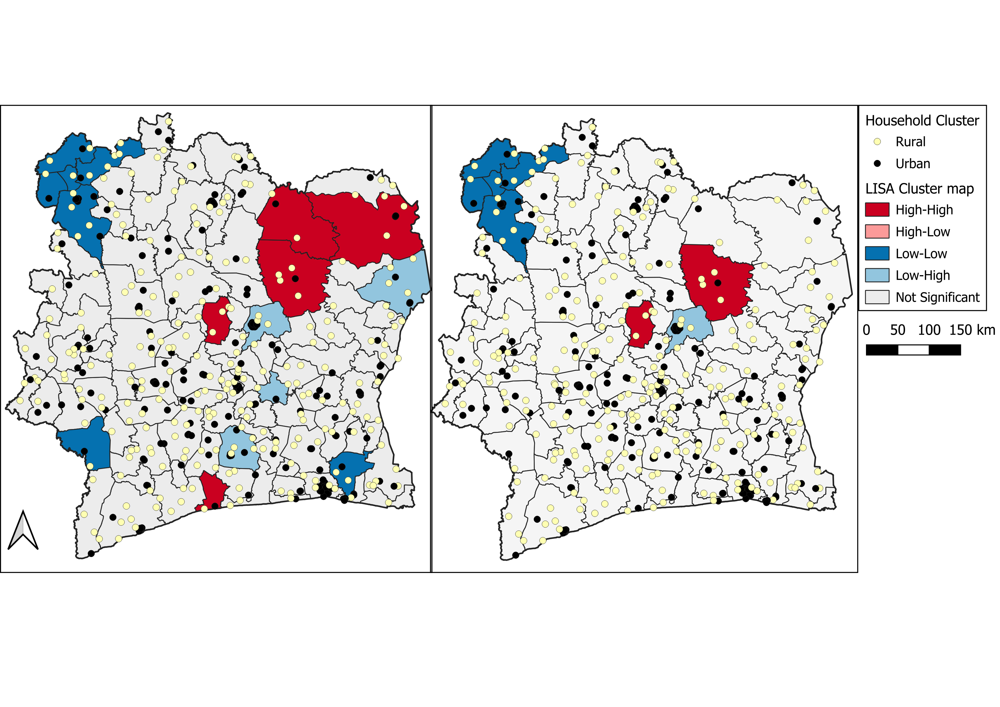
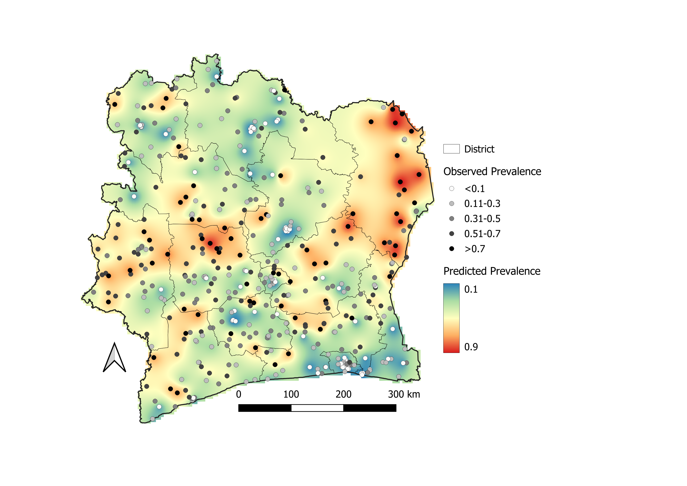
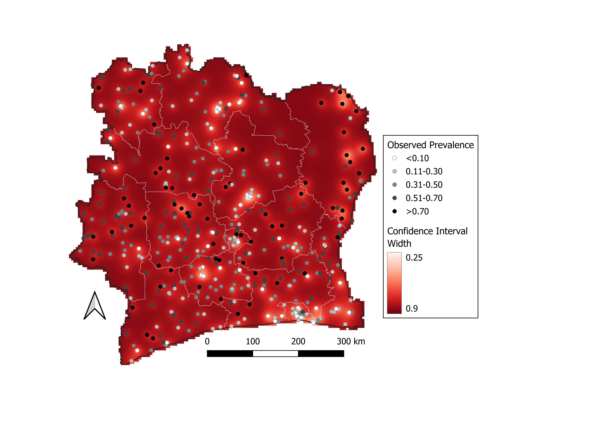
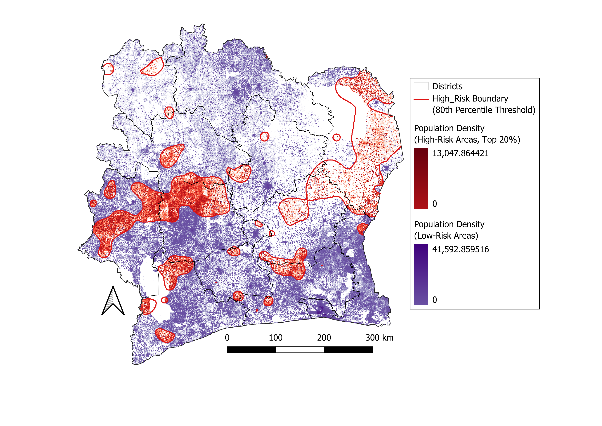
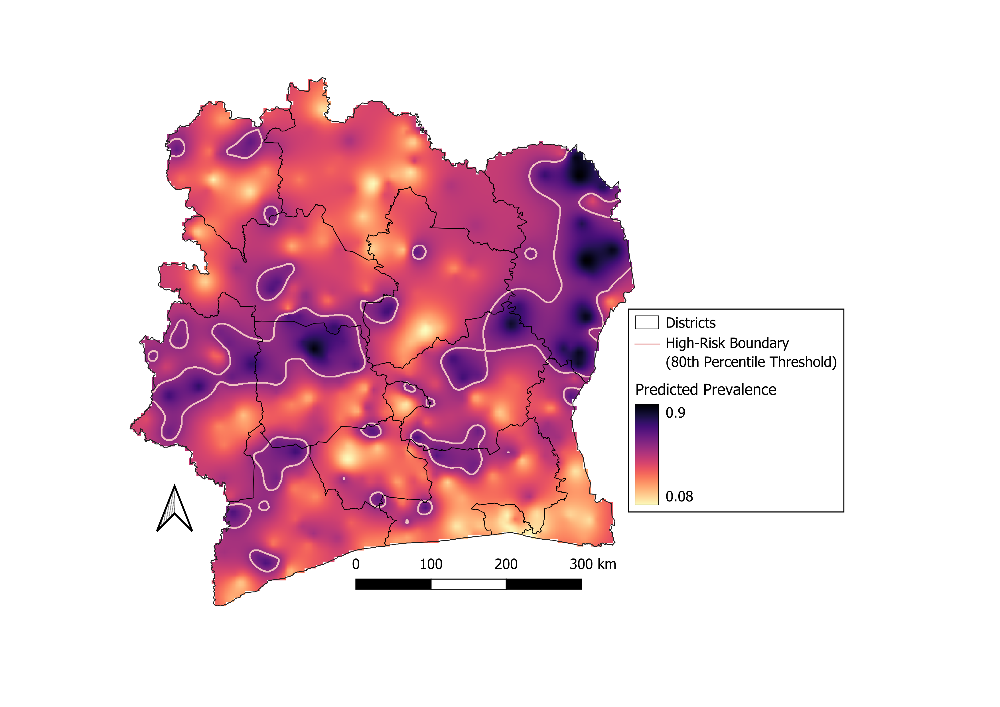

# Spatial Epidemiology of Sanitation & Childhood Malaria in Côte d'Ivoire

[](https://www.r-project.org/)
[](https://www.qgis.org/)
[](https://dhsprogram.com/)
[](https://opensource.org/licenses/MIT)

> **MSc Spatial Epidemiology in Public Health Project**  
> *London School of Hygiene & Tropical Medicine (LSHTM)*  
> **Author:** Beth  
> **Methodologies:** Exploratory Spatial Data Analysis (ESDA), Spatial Autocorrelation (Global & Local Moran's $I$), Empirical Variography, Theoretical Semivariogram Modeling, Ordinary Kriging Interpolation, Gridded Population Zonal Integration (WorldPop).

---

## Executive Summary

This repository presents an end-to-end spatial epidemiological investigation of two critical public health priorities in **Côte d'Ivoire**, utilizing microdata and geographic cluster records from the **2021 Demographic and Health Survey (DHS)**:

1. **Household Sanitation & Open Defecation (SDG 6.2):** Spatial patterns and local clustering of open defecation across 106 administrative departments (Admin 2).
2. **Childhood Malaria Endemicity (SDG 3.3):** Geostatistical surface modeling of Rapid Diagnostic Test (RDT) positivity in children aged 6–59 months across 468 survey clusters, coupled with high-resolution gridded population data (WorldPop 1 km) to quantify populations exposed to high transmission risk.

### The Hybrid R + QGIS Workflow

In epidemiological research and humanitarian health informatics (e.g., LSHTM, WHO, CDC, UNICEF), data scientists combine **statistical computing environments** with **dedicated GIS software**:
- **R (`sf`, `terra`, `spdep`, `gstat`, `automap`, `geoR`)** executes rigorous spatial econometrics, Monte Carlo hypothesis testing, variance-stabilizing transformations, variogram fitting, ordinary kriging, and zonal extractions.
- **QGIS (3.x)** provides publication-standard cartographic production, multi-layered visual hierarchies, exact coordinate layout grids, and print-ready thematic maps.

All spatial outputs produced in R (GeoTIFFs, GeoPackages, GeoJSONs) are pre-configured to load directly into the included QGIS project files (`.qgz`).

---

## Table of Contents

- [Key Findings](#key-findings)
- [Methodological Framework](#methodological-framework)
- [Part 1: Open Defecation & Spatial Autocorrelation](#part-1-open-defecation--spatial-autocorrelation)
- [Part 2: Childhood Malaria Geostatistical Modeling & Kriging](#part-2-childhood-malaria-geostatistical-modeling--kriging)
- [Part 3: Population-at-Risk Integration (WorldPop)](#part-3-population-at-risk-integration-worldpop)
- [Part 4: Public Health Policy & Survey Design](#part-4-public-health-policy--survey-design)
- [Repository Structure](#repository-structure)
- [Reproducibility & How to Run](#reproducibility--how-to-run)
- [Software & R Packages](#software--r-packages)

---

## Key Findings

| Domain | Key Metric / Result | Epidemiological Interpretation |
| :--- | :--- | :--- |
| **Open Defecation (Admin 2)** | Global Moran's $I = 0.290$ ($p < 0.001$, 9,999 MC sims) | Highly significant positive spatial autocorrelation; sanitation deprivation clusters geographically rather than being randomly distributed. |
| **Sanitation Hotspots (LISA)** | High-High clusters concentrated in the north & northeast | Statistically confirmed hotspots in Zanzan and northern departments (up to 39.4% district prevalence), contrasting sharply with Abidjan (4.3%). |
| **Malaria Endemicity (Clusters)** | Mean child prevalence = 39.0% (IQR: 17.0%–60.0%) | Stark rural–urban disparity: rural cluster median positivity is 53.0% vs. 17.0% in urban centers. |
| **Spatial Structure (Variogram)** | Exponential model, Practical Range = **58.5 km** | 68.8% of total variance is attributable to spatial structure. Kriging borrows information up to ~58.5 km. |
| **Cross-Validation** | Mean Squared Normalised Error (**MSNE**) = **0.978** | Near-optimal MSNE ($\approx 1.0$) validates that kriging prediction standard errors accurately capture true uncertainty. |
| **Population at High Risk** | **3.81 million people** (13.02% nationally) | Reside in areas exceeding the 80th percentile risk threshold ($\ge 54.0\%$ prevalence). Montagnes bears the largest absolute count (~1.0M), while Zanzan has the highest proportional burden (65.4%). |

---

## Methodological Framework



---

## Part 1: Open Defecation & Spatial Autocorrelation

### Analytical Rationale & Spatial Scale
Sanitation data were analyzed at the **Admin 2 (department, $n = 106$)** scale rather than the regional scale (Admin 1, $n = 14$). Aggregating to departments preserves fine-grained local variation, reveals urban–rural boundaries, and mitigates the Modifiable Areal Unit Problem (MAUP) and ecological fallacy.

### Spatial Weights & Neighborhood Structure
Spatial neighbors were defined using **Queen contiguity** (sharing a boundary edge or vertex). Every department had valid neighbors (ranging from 2 to 9, average: 5.25 links, 0 isolated units). **Row-standardized spatial weights (`style = "W"`)** were applied, ensuring that peripheral units with fewer neighbors were not artificially dampened in the spatial lag calculations.

### Global & Local Moran's $I$ Results
- **Global Moran's $I$:** $0.2901$ ($z = 5.09$, analytical $p < 0.0001$). Under 9,999 Monte Carlo permutations, the pseudo-$p$ value was $0.0001$, firmly rejecting the null hypothesis of Complete Spatial Randomness (CSR).
- **Local Moran's $I$ (LISA):** Identified distinct **High-High clusters** in northern and northeastern departments (Zanzan, Savanes) and **Low-Low clusters** in southern coastal departments (around Abidjan and Lagunes). Several **Low-High outliers** were detected at cluster boundaries, marking sharp transitional zones between urban service access and rural deprivation.

<p align="center">
  
  
</p>
<p align="center"><em><strong>Figure 2 & 9: Spatial Analysis of Open Defecation in Côte d'Ivoire.</strong> (Left) Department-level open defecation proportions classified by quantiles. (Right) Local Moran's I (LISA) cluster typology at p &le; 0.05 showing northern hotspots (red) and southern coldspots (blue).</em></p>

---

## Part 2: Childhood Malaria Geostatistical Modeling & Kriging

### Empirical Logit Transformation
Across 468 survey clusters, 4,681 children aged 6–59 months were tested with Rapid Diagnostic Tests (RDTs), revealing a pronounced **rural–urban disparity** (rural median positivity: 53.0% [IQR: 30%–69%] vs. urban median: 17.0% [IQR: 0%–38%]).

Cluster test positivity rates are bounded on $[0, 1]$ and heteroscedastic. To satisfy the Gaussian and stationarity assumptions required for linear geostatistical prediction, prevalence was transformed to the **empirical logit scale**:

$$\text{logit}(p_i) = \ln\left(\frac{y_i + 0.5}{n_i - y_i + 0.5}\right)$$

where $y_i$ is the number of positive RDTs and $n_i$ is the number of children tested in cluster $i$. Adding $0.5$ provides continuity correction for zero-count and complete-infection clusters.

### Variography & Theoretical Semivariogram Model
An empirical semivariogram was estimated across 15 distance lags with a **95% Monte Carlo simulation envelope** under spatial randomness. Point pairs at short lag distances plotted significantly above the envelope, confirming strong spatial structure up to ~50–60 km.

Using weighted least squares (`automap::autofitVariogram`), an **Exponential model** demonstrated the best fit:
- **Nugget ($c_0$):** $0.529$ (microscale variation and measurement error)
- **Partial Sill ($c$):** $1.170$ | **Total Sill ($c_0 + c$):** $1.699$
- **Spatial Structure Ratio:** $\frac{1.170}{1.699} = 68.8\%$ (over two-thirds of total variance is spatially structured)
- **Range Parameter ($a$):** $19.49\text{ km}$ $\rightarrow$ **Practical Range ($3a$):** **$58.46\text{ km}$** (kriging borrows spatial information up to ~58.5 km)

### Ordinary Kriging & Uncertainty Surfaces
Predictions were computed across a **5 km national regular grid** reprojected to EPSG:3857, then back-transformed to continuous prevalence and standard errors:

$$\hat{p}(s_0) = \frac{1}{1 + \exp(-\hat{Z}(s_0))}, \quad \text{95% CI} = \left[\text{logit}^{-1}(\hat{Z} - 1.96\sigma), \; \text{logit}^{-1}(\hat{Z} + 1.96\sigma)\right]$$

<p align="center">
  
  
</p>
<p align="center"><em><strong>Figure 15: Ordinary Kriging Model Outputs for Childhood Malaria in Côte d'Ivoire.</strong> (Left) Predicted continuous prevalence surface back-transformed from empirical logit. (Right) Prediction 95% confidence interval width, illustrating lowest uncertainty near dense cluster clusters and highest uncertainty in sparsely sampled northern border regions.</em></p>

### 10-Fold Cross-Validation Metrics

| Validation Metric | Value | Diagnostic Assessment |
| :--- | :---: | :--- |
| **Mean Error (ME)** | $0.038$ | Negligible prediction bias (near 0) |
| **Mean Absolute Error (MAE)** | $0.876$ | Average absolute prediction error |
| **Mean Squared Error (MSE)** | $1.241$ | Overall variance of prediction errors |
| **Mean Squared Normalised Error (MSNE)** | **$0.978$** | **Optimal calibration** (benchmark: 1.0; confirms kriging standard errors accurately represent uncertainty) |
| **Observed vs. Predicted Correlation ($r$)** | **$0.589$** | Strong predictive fidelity across unseen survey clusters |

---

## Part 3: Population-at-Risk Integration (WorldPop)

Continuous risk surfaces alone do not reflect disease burden without incorporating human population distribution. We integrated the kriged malaria raster with the **2021 WorldPop 1 km constrained gridded population raster**.

### High-Risk Endemicity Threshold
Because clinical malaria endemicity lacks a single universal cut-off, high risk was defined as the **80th percentile of predicted prevalence ($\ge 54.0\%$)**, isolating the top transmission quintile. A quantile-based threshold provides a reproducible, defensible criterion for public health intervention targeting.

As demonstrated below, the high-risk zones form two distinct epidemiological corridors:
1. **Eastern Zone:** A broad, sparsely populated high-transmission area across Zanzan.
2. **Western Zone:** A more densely populated high-burden zone across Montagnes.

<p align="center">
  
  
</p>
<p align="center"><em><strong>Figure 16: Spatial analysis of malaria risk and population exposure in Côte d'Ivoire.</strong> (A) Gridded population density in low-risk zones (purple gradient) vs. high-risk zones (red gradient). (B) Continuous interpolated surface of predicted prevalence with 80th percentile high-risk boundary overlay (pink outline).</em></p>

### District Zonal Exposure Statistics

| District | Total Population | High-Risk Population | Proportion at Risk (%) | Primary Risk Profile |
| :--- | :---: | :---: | :---: | :--- |
| **Montagnes** | 3,000,000 | **1,000,526** | 33.4% | Highest absolute number of exposed individuals |
| **Zanzan** | 1,340,000 | **875,767** | **65.4%** | Highest proportional risk; widespread transmission |
| **Sassandra-Marahoué** | 2,700,000 | 734,223 | 27.2% | Substantial population in agricultural zones |
| **Lacs** | 1,470,000 | 354,515 | 24.1% | Central high-transmission corridor |
| **Bas-Sassandra** | 2,660,000 | 313,233 | 11.8% | Localized hotspots in southern interior |
| **Woroba** | 1,180,000 | 154,666 | 13.1% | Clustered rural transmission |
| **Lagunes** | 2,230,000 | 129,984 | 5.8% | Low risk except peri-urban fringe |
| **Abidjan** | 6,290,000 | **0** | **0.0%** | Urban protection, lower vector density |
| **National Total** | **29,290,000** | **3,810,000** | **13.02%** | **~3.81 million people in high-risk zones** |

### Uncertainty Sensitivity Analysis
Using the kriging 95% confidence intervals to evaluate boundary uncertainty:
- **Conservative Scenario (Lower 95% CI $\ge 54\%$):** 0 million (areas where prevalence is definitively above 54% at $p < 0.025$).
- **Expected Point Estimate:** **3.81 million** (13.02% of population).
- **Inclusive Scenario (Upper 95% CI $\ge 54\%$):** 21.7 million (areas where prevalence could plausibly reach 54% within 95% confidence bounds).

---

## Part 4: Public Health Policy & Survey Design

### 1. Optimal Allocation of 100 Additional DHS Survey Clusters
If supplemental funding permitted 100 new survey clusters, the design should prioritize a **hybrid risk–uncertainty optimization**:
- **Montagnes & Bas-Sassandra (~50 clusters):** Dense populations living in boundary areas where prediction confidence intervals are wide. Placing clusters here directly clarifies whether millions of residents fall above or below intervention thresholds.
- **Savanes & Northern Border (~30 clusters):** Border areas currently have sparse sampling (>58.5 km from existing clusters), causing kriging to revert toward the national mean and hiding potential epidemic incursions from neighboring countries.
- **Zanzan Northern Reach (~10 clusters):** Unsampled populated pockets near the Comoé National Park boundary.
- **Trade-Off Analysis:** Prioritizing population risk exposure rather than uniform geographic coverage means remote, uninhabited zones remain uncharacterized, but programmatic return on investment for interventions (LLINs, SMC) is maximized.

### 2. DHS Survey Prevalence vs. PMI Routine Health Facility Incidence
- **President's Malaria Initiative (PMI) Routine Incidence:** Derived from monthly health facility registers. Captures symptomatic illness seeking formal care. Heavily biased by healthcare access, clinical stockouts, and reporting completeness.
- **DHS Point Prevalence (This Study):** Population-based active screening of children 6–59 months in households. Captures asymptomatic and symptomatic parasitemia independent of healthcare-seeking behavior.
- **Strategic Utility:** PMI data are ideal for health system capacity and commodity logistics at administrative levels; geostatistical DHS surfaces are superior for sub-national targeting of community interventions (e.g., Seasonal Malaria Chemoprevention and indoor residual spraying).

---

## Visual Map Catalog & Cartography Guide

Below is a complete guide to all cartographic map layouts exported in `figures/` and their corresponding figures in the analysis:

| Map File in `figures/` | Report Figure Reference | Thematic Focus & Layer | Cartographic & Methodological Specification |
| :--- | :--- | :--- | :--- |
| `map01_open_defecation_choropleth.png` | **Figure 2** | Open Defecation by Department (Admin 2) | Classified using 5 quantile breaks on a continuous spectral palette; outlines 106 departmental polygons. |
| `map02_baseline_population_density.png` | **Figure 3** | National Baseline Population Density | 1 km WorldPop constrained population raster rendered in continuous purple gradient; overlays Admin 1 and Admin 2 borders. |
| `map03_lisa_significance_levels.png` | **Figure 7** | Local Moran's $I$ Significance Levels | Classified by $p$-value thresholds: $p < 0.01$ (dark green), $0.01 \le p < 0.05$ (light green), $p \ge 0.05$ (grey). |
| `map04_lisa_clusters_and_outliers.png` | **Figure 9** | LISA Clusters and Spatial Outliers | Categorical classification at $p < 0.05$ & $p < 0.01$: High-High (red), Low-Low (dark blue), Low-High (light blue). |
| `map05_observed_malaria_cluster_prevalence.png` | **Figure 11A** | Observed Cluster & District Malaria Risk | District mean RDT positivity (choropleth) overlaid with proportional graduated cluster circles ($n = 468$). |
| `map06_malaria_clusters_on_population_density.png` | **Figure 11B** | Malaria Clusters & Population Density | Observed cluster positivity circles overlaid on 1 km gridded population density (highlighting survey coverage gaps). |
| `map07_kriged_malaria_prevalence_surface.png` | **Figure 15A** | Ordinary Kriging Predicted Prevalence | 5 km continuous interpolated prevalence raster back-transformed from logit scale, masked to national boundary. |
| `map08_kriging_uncertainty_ci_width.png` | **Figure 15B** | Prediction Confidence Interval Width | Continuous uncertainty surface ($95\%\text{ CI width} = \text{Upper} - \text{Lower}$); narrow near clusters, wide in remote north. |
| `map09_population_exposed_high_risk_zones.png` | **Figure 16A** | Population in High-Risk Zones | 1 km WorldPop raster split by the $80\text{th}$ percentile threshold ($\ge 54\%$ prevalence): red (high risk) vs. purple (low risk). |
| `map10_predicted_prevalence_with_high_risk_boundary.png` | **Figure 16B** | Kriged Prevalence with High-Risk Boundary | Continuous interpolated prevalence surface with the empirical $80\text{th}$ percentile threshold contour overlaid in pink. |

---

## Repository Structure

```text
├── figures/                                                # Publication-ready QGIS maps (not generated by R)
│   ├── map01_open_defecation_choropleth.png                # Admin 2 open defecation quantile map (Fig 2)
│   ├── map02_baseline_population_density.png               # Baseline WorldPop 1km population density (Fig 3)
│   ├── map03_lisa_significance_levels.png                  # LISA statistical significance map (Fig 7)
│   ├── map04_lisa_clusters_and_outliers.png                # Local Moran's I cluster & outlier map (Fig 9)
│   ├── map05_observed_malaria_cluster_prevalence.png       # Observed clusters on district mean choropleth (Fig 11A)
│   ├── map06_malaria_clusters_on_population_density.png    # Cluster positivity on population density (Fig 11B)
│   ├── map07_kriged_malaria_prevalence_surface.png         # Ordinary Kriging continuous prevalence surface (Fig 15A)
│   ├── map08_kriging_uncertainty_ci_width.png              # Kriging 95% CI width uncertainty surface (Fig 15B)
│   ├── map09_population_exposed_high_risk_zones.png        # Population exposed in high-risk zones (Fig 16A)
│   └── map10_predicted_prevalence_with_high_risk_boundary.png # Predicted prevalence with high-risk boundary (Fig 16B)
├── functions.R                                             # Custom R functions (variogram envelopes, plotting)
├── r_script.R                                              # Standalone runnable R analysis script
├── r_markdown_script.Rmd                                   # Fully annotated R Markdown analytical notebook
├── .gitignore                                              # Excludes raw data, exploratory plots, TIFF rasters, & academic files
└── README.md                                               # Project documentation and portfolio presentation
```

---

## Reproducibility & How to Run

### Data Access & Requirements
To reproduce this analysis locally, request access to the **2021 Côte d'Ivoire Demographic and Health Survey (DHS)** microdata via [The DHS Program](https://dhsprogram.com/). Place the survey files and OCHA administrative boundary shapefiles in a local `data/` folder matching the variable names outlined in the scripts.

### Option A: Run the Standalone R Script
To execute the complete analysis pipeline from the terminal:

```bash
Rscript r_script.R
```

### Option B: Render the R Markdown Notebook
Open `r_markdown_script.Rmd` in RStudio and click **Knit**, or execute in R:

```r
rmarkdown::render("r_markdown_script.Rmd")
```

---

## Software & R Packages

The analysis was performed with **R version 4.5+** and **QGIS 3.x**. Key libraries include:

- **Vector & Raster GIS:** `sf` (v1.0+), `terra` (v1.8+), `tmap` (v4.0)
- **Spatial Autocorrelation & Econometrics:** `spdep` (v1.3+)
- **Geostatistics & Variography:** `automap` (v1.1+), `gstat` (v2.1+), `geoR` (v1.9+)
- **Data Wrangling & Tables:** `dplyr`, `tidyr`, `stringr`, `janitor`, `gt`, `tableone`
- **Visualization:** `ggplot2`, `scales`

---

## Author & Citation

**Beth**  
*MSc Spatial Epidemiology in Public Health*  
London School of Hygiene & Tropical Medicine (LSHTM)  

*Data Sources: Demographic and Health Surveys (DHS) Program (2021 Côte d'Ivoire DHS); UN OCHA / Humanitarian Data Exchange; WorldPop Project (University of Southampton).*
